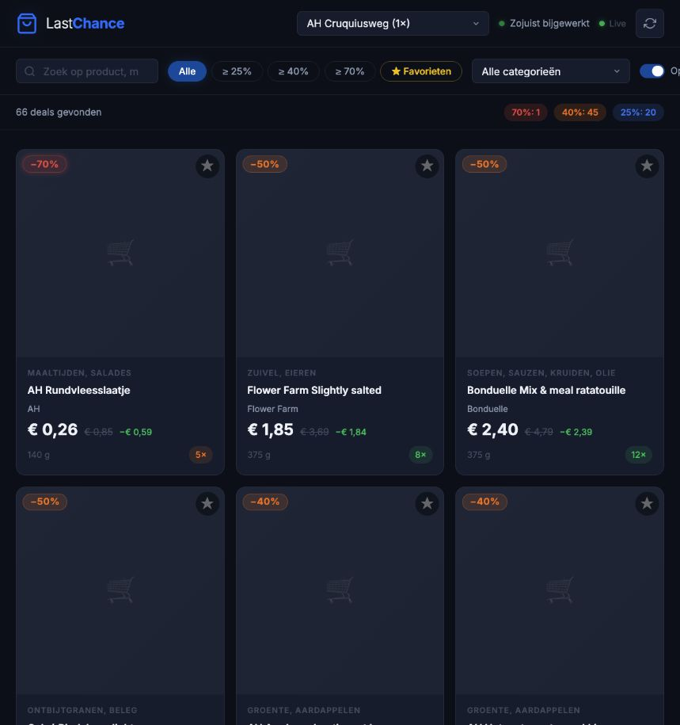

# AH Last Chance Tracker

A self-hosted dashboard for Albert Heijn **Laatste Kans Koopjes**: products marked
down before their expiry date. Track bargains at your chosen stores, compare price
and stock changes over time, and receive alerts when discounts increase or stock
runs low.

The dashboard includes discount, category, stock and search filters, favourites
saved in your browser, and a price-history chart. New collection results arrive
through Server-Sent Events (SSE), so open dashboards update automatically. Product
cards show an image when one is available and a shopping-cart fallback otherwise.

The application uses Python, FastAPI and SQLite. The frontend is vanilla JavaScript
and CSS with Chart.js; there is no Node.js dependency or frontend build step.



Dashboard shown with existing locally stored snapshots. Images populate after a
successful product-image lookup; this capture shows the fallback cards.

## Prerequisites

- Python **3.11 or newer**, Git, and an Albert Heijn account.
- A browser for the interactive AH login and dashboard.
- Network access to the AH API and, if enabled, your notification service.
- Docker with the Compose plugin for the optional container setup.

## Local setup

Run these commands from the repository root. The activation command below is for
macOS/Linux; on Windows use `.venv\Scripts\Activate.ps1` in PowerShell.

```bash
git clone https://github.com/Alongoodall/ah-last-chance-tracker.git
cd ah-last-chance-tracker
python3 -m venv .venv
source .venv/bin/activate
python -m pip install -e ".[dev]"
cp .env.example .env
```

Edit `.env` and set at least the stores to collect, for example:

```dotenv
AH_STORE_IDS=2301
AH_STORE_NAMES=2301:AH Cruquiusweg
```

Create the data directory and apply the database migrations **before** collecting
or starting the server. This is required both for fresh installations and after
updates that change the database schema.

```bash
mkdir -p data
python -m alembic upgrade head
python scripts/ah_login.py
python scripts/collect_once.py --verbose
uvicorn app.main:app --app-dir backend --reload
```

Open [the dashboard](http://localhost:8000). Interactive API documentation is at
[/docs](http://localhost:8000/docs), and the health check is at
[/api/health](http://localhost:8000/api/health).

The login script opens a browser and captures the AH authorization redirect. If
that flow fails, use `python scripts/ah_login.py --manual` and follow its prompts.
Check saved authentication with `python scripts/ah_auth_status.py`. The client
refreshes access tokens automatically when possible; log in again if the refresh
token is rejected.

Tokens are stored outside the repository, by default in
`~/.config/ah-last-chance-tracker/tokens.json`. The token file has owner-only
permissions (`0600`), and its directory has `0700` permissions where supported.
Keep tokens and `.env` out of source control.

The server starts scheduled collection when `AH_STORE_IDS` is set. Its first
scheduled run happens after `COLLECTION_INTERVAL_MINUTES`, so the one-shot command
above seeds the dashboard immediately. Restart the server after changing settings.
Use one server worker, and stop the server before running a manual collection
against the same SQLite database.

## Adding stores

Search using a postal code, then copy the store IDs shown by the script:

```bash
python scripts/find_store.py 1091
```

Configure multiple stores with comma-separated values:

```dotenv
AH_STORE_IDS=2301,2203
AH_STORE_NAMES=2301:AH Cruquiusweg,2203:AH Eerste Oosterparkstraat
AH_STORE_POSTAL_CODES=2203:1091GH
```

Postal-code mappings let the collector look up a store's name and address.
`AH_STORE_NAMES` overrides the returned display name. Direct AH store-ID lookup
can be unreliable, so postal codes and name overrides are useful.

To collect a specific store, or several stores, use the repeatable `--store-id`
option. This selects stores for that run without changing `.env`:

```bash
python scripts/collect_once.py --store-id 2301 --store-id 2203 --verbose
```

## Configuration

Application settings are loaded from environment variables and `.env` in the
current working directory. Environment variables take precedence. Run commands
from the repository root so the intended `.env` and relative database path are
used. See [`.env.example`](.env.example) for a starting configuration.

| Variable | Default | Purpose and example |
|---|---|---|
| `APP_NAME` | `AH Last Chance Tracker` | Application name used in API documentation and startup logs. |
| `DEBUG` | `false` | Pretty console logs and SQL query logging; example: `true`. |
| `DATABASE_URL` | `sqlite+aiosqlite:///data/ah_tracker.db` | Async SQLAlchemy database URL. Absolute SQLite example: `sqlite+aiosqlite:////srv/ah/ah_tracker.db`. |
| `AH_STORE_IDS` | Empty | Comma-separated store IDs; example: `2301,2203`. Empty disables scheduled collection. |
| `AH_STORE_POSTAL_CODES` | Empty | Optional `storeId:postalCode` pairs; example: `2203:1091GH`. |
| `AH_STORE_NAMES` | Empty | Optional `storeId:Name` overrides; example: `2301:AH Cruquiusweg,2203:AH Eerste Oosterparkstraat`. |
| `COLLECTION_INTERVAL_MINUTES` | `10` | Polling interval in minutes; minimum `1`. |
| `AH_RETENTION_DAYS` | `30` | Delete snapshots older than this many days after a collection cycle. `0` keeps history forever; negative values are invalid. |
| `AH_NOTIFY_URL` | Empty | ntfy topic URL; example: `https://ntfy.sh/your-unique-ah-topic`. Empty disables push notifications. |
| `AH_SMTP_HOST` | Empty | SMTP server hostname; example: `smtp.example.com`. Email requires a host and recipient. |
| `AH_SMTP_PORT` | `587` | SMTP port; the sender uses STARTTLS. |
| `AH_SMTP_USER` | Empty | SMTP login username; example: `tracker@example.com`. Empty skips SMTP authentication. |
| `AH_SMTP_PASSWORD` | Empty | SMTP password or provider app password. |
| `AH_SMTP_FROM` | Empty | Sender address; example: `tracker@example.com`. Falls back to `AH_SMTP_USER`. |
| `AH_SMTP_TO` | Empty | Recipient address; example: `you@example.com`. Empty disables email delivery. |

The following variables belong to token storage, Docker Compose or the container
entrypoint. **Export them in your shell**, or supply them through Docker's
environment configuration. Do not add them to the application's `.env`: unknown
keys in that file are rejected by the settings loader.

| Variable | Default | Purpose and example |
|---|---|---|
| `AH_TOKEN_DIR` | Unset locally; `/config/tokens` in Docker | Directory containing `tokens.json`; takes priority over `XDG_CONFIG_HOME`. Example: `/srv/ah-tokens`. It must be writable. |
| `XDG_CONFIG_HOME` | Unset | If set and `AH_TOKEN_DIR` is absent, tokens are stored under `$XDG_CONFIG_HOME/ah-last-chance-tracker`. Otherwise `~/.config/ah-last-chance-tracker` is used. |
| `TRACKER_PORT` | `8000` | Docker Compose host port; example: `8080` maps host port 8080 to container port 8000. |
| `AH_TOKEN_HOST_DIR` | `$HOME/.config/ah-last-chance-tracker` | Docker Compose host directory mounted at `/config/tokens`; example: `/srv/ah-tokens`. |
| `HOST` | `0.0.0.0` | Container entrypoint's uvicorn bind address. Local uvicorn uses its command-line options. |
| `PORT` | `8000` | Container entrypoint's internal port. Keep `8000` with the supplied Compose port mapping and health checks. |
| `WORKERS` | `1` | Container uvicorn worker count. Keep `1`: each worker would start its own collector and SQLite supports a single writer. |

## Notifications

Alerts compare each store's current snapshot with its previous snapshot:

- A discount crosses upward into a new tier: **25%, 40% or 70%**.
- A new item appears with at least **40%** discount.
- An existing item's stock drops from more than one to **one**, with at least **25%** discount.

The first collected snapshot can trigger new-item alerts. Notification channel
failures are logged without stopping collection. Notifications cover all tracked
products; dashboard favourites are stored only in your browser.

### ntfy push notifications

1. Choose a unique topic name, such as `your-unique-ah-topic`.
2. Install the [ntfy app](https://ntfy.sh) on your phone and subscribe to that topic
   on the same ntfy server.
3. Set `AH_NOTIFY_URL=https://ntfy.sh/your-unique-ah-topic` in `.env` and restart
   the tracker.

A self-hosted ntfy topic URL also works. The tracker sends a plain HTTP POST to
the configured URL; it does not configure separate ntfy authentication headers.
Public topic names can be subscribed to by anyone who knows them.

### SMTP email

Set `AH_SMTP_HOST`, `AH_SMTP_PORT`, `AH_SMTP_TO` and a sender address using
`AH_SMTP_FROM` or `AH_SMTP_USER`. For servers requiring authentication, also set
`AH_SMTP_USER` and `AH_SMTP_PASSWORD` using credentials supplied by your provider.
Use a provider app password if required.

The sender always upgrades the connection with **STARTTLS**, typically on port
587. Implicit TLS on port 465 is not supported. Restart after configuration
changes. Push and email can be enabled together, or both left disabled.

## Docker quick start

From a cloned repository, run these three commands. After the first command, edit
`.env` to set `AH_STORE_IDS` and any desired notification settings. If you already
have a configured `.env`, preserve it instead of overwriting it.

```bash
cp .env.example .env
docker compose up -d --build
docker compose exec tracker python scripts/ah_login.py --manual
```

Use the manual login instructions in your host browser, then open
[the dashboard](http://localhost:8000). Collection runs on the configured interval;
allow one interval after login for the first results.

The entrypoint applies Alembic migrations on every start. Compose persists the
database in `./data` and mounts the host token directory at `/config/tokens`.
It overrides `DATABASE_URL` and `AH_TOKEN_DIR` to use those mounted paths. Existing
host tokens can therefore be reused without another login when the same token
directory is mounted.

The container runs as an unprivileged `appuser`. Ensure both mounted directories
are writable by that user, especially on Linux. A `Permission denied` or
`unable to open database file` error usually means the bind-mount ownership or
permissions need adjusting. For a custom token directory or host port, export
`AH_TOKEN_HOST_DIR` or `TRACKER_PORT` in your shell before starting Compose.

Useful management commands:

```bash
docker compose logs -f tracker
docker compose up -d --build
docker compose down
```

## Database maintenance and updates

Snapshots and their bargain items are pruned once after each complete collection
cycle according to `AH_RETENTION_DAYS`. Product and store metadata remain.
Pruned observations disappear from price history. SQLite may reuse the freed
pages without shrinking the database file immediately.

Stop the tracker before backing up `data/ah_tracker.db` or applying local schema
updates. After updating the code, activate the virtual environment and run:

```bash
python -m pip install -e ".[dev]"
python -m alembic upgrade head
```

Then restart uvicorn. Docker applies migrations when the rebuilt container starts.
Use `python -m alembic current` to inspect the current migration revision.

## Architecture and API

```text
AH private GraphQL / REST API
            |
      CollectorService <--- APScheduler (every 10 minutes by default)
            |
       SQLite snapshots
            |
      FastAPI REST API ---> vanilla JS dashboard + Chart.js
            |
       EventBus / SSE ---> live dashboard updates

Snapshot comparison ---> ntfy / SMTP alerts
Collection cycle    ---> retention cleanup
```

`backend/app/ah/` handles authentication and API responses.
`backend/app/collector.py` orchestrates collection, persistence and notifications.
`backend/app/db/` contains the SQLAlchemy models, async sessions and repository;
`alembic/` contains database migrations. API routes live in `backend/app/api/`,
and the dashboard assets live in `backend/app/static/`.

Product images are resolved in batches through AH's REST product-search endpoint
using returned `images[].url` values, then cached in the product database for
reuse across stores and later polls. `webshop_id` is retained when available;
image URLs are not guessed from that ID. Image lookup is best effort, so missing
images or a failed lookup do not prevent bargain collection. The GraphQL client
falls back to its original query if AH specifically rejects the `webshopId` field.

| Endpoint | Purpose |
|---|---|
| `GET /` | Dashboard. |
| `GET /api/health` | Database status, scheduler status and configured stores. |
| `GET /api/stats` | Snapshot and product counts, oldest/newest snapshot times, and database file size in bytes. |
| `GET /api/stores` | Collected stores with snapshot counts. |
| `GET /api/stores/{store_id}` | Store metadata. |
| `GET /api/stores/{store_id}/snapshots` | Snapshot history, newest first; `limit` defaults to 50, is capped at 200, and `offset` supports pagination. |
| `GET /api/stores/{store_id}/bargains` | Latest bargains; supports `snapshot_id`, `min_discount`, `category` and `in_stock` (default `true`). |
| `GET /api/products/{product_id}` | Product metadata, including available image and webshop ID. |
| `GET /api/products/{product_id}/history?store_id={store_id}` | Store-specific price history, oldest first; `store_id` is required and `limit` defaults to 100, maximum 500. |
| `GET /api/events` | SSE stream with `snapshot_ready` events and a keepalive every 30 seconds. |
| `GET /docs` | Interactive API documentation. |

Prices are stored as integer euro cents and converted to euro floats only in API
responses. Statistics timestamps describe retained history; an empty database
has no oldest or newest snapshot. `db_size_bytes` includes SQLite's main database,
WAL and shared-memory files; it is `0` for an in-memory database.

## Development

Install the development dependencies as shown above, then run the full suite
after every change:

```bash
python -m pytest -q
```

For schema changes, add and review an Alembic migration, then apply it:

```bash
python -m alembic revision --autogenerate -m "describe the schema change"
python -m alembic upgrade head
```

Edit the dashboard directly in `backend/app/static/app.js` and `style.css`.
Keep credentials out of code, fixtures and test output.

## Known limitations

- The tracker depends on a private AH API. Authentication, field availability and
  response formats can change without notice.
- AH's GraphQL `Product` type does not expose an `images` field. Product images
  use a separate REST lookup; cards retain a fallback when an image is missing.
  Live verification on 12 October 2026 was blocked by HTTP 503 responses from AH's
  GraphQL and REST APIs, so live image population could not be confirmed that day.
- SQLite supports a single writer. Run one application worker and avoid separate
  collectors writing to the same database at the same time.
- Discounts and stock reflect the most recent successful poll, so a deal may
  change or sell out before you reach the store. A failed poll leaves the previous
  snapshot visible while it remains within the retention period.
- Store lookup by ID is unreliable; use postal-code mappings or display-name
  overrides when necessary.
- Favourites are local to each browser and do not configure notifications.
- The dashboard and API have no application login. Access control for a hosted
  deployment must be provided by the surrounding network or proxy.
